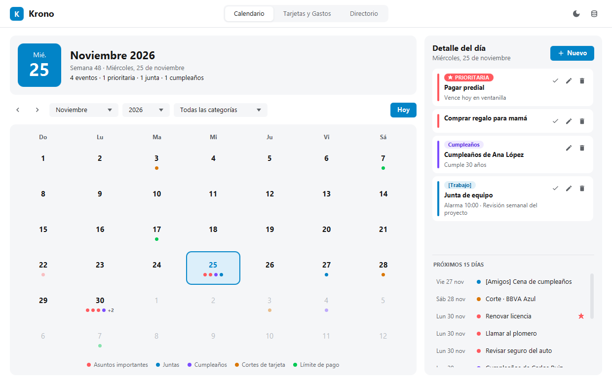
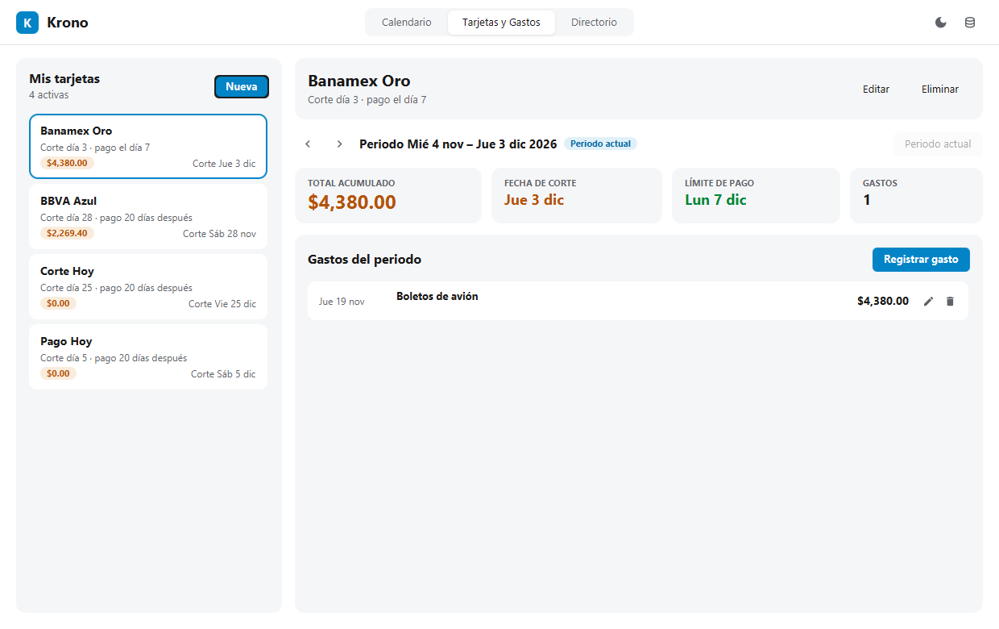
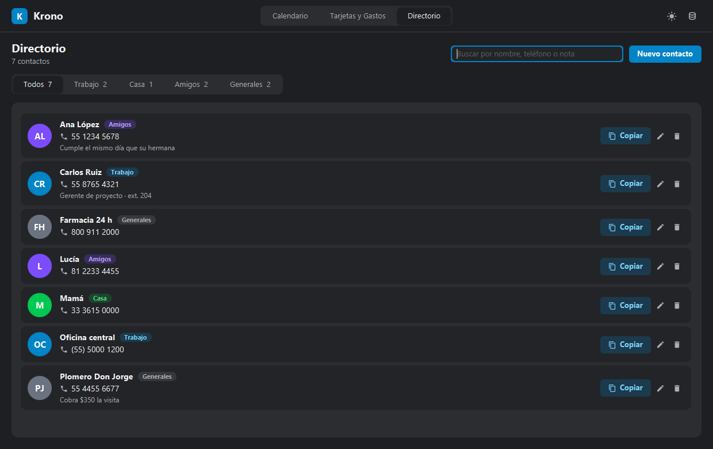
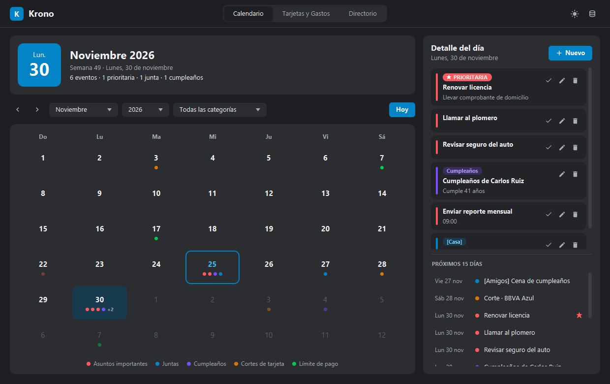

# Krono

Aplicación de escritorio personal que reúne en un solo lugar un **calendario interactivo**, el **control de gastos de tarjetas de crédito** y un **directorio telefónico**. Hecha en Java 21 y JavaFX 21, guarda los datos en PostgreSQL y sigue funcionando en la bandeja del sistema de Windows para avisarte de tus alarmas.



## Funciones

### Calendario
- **Varios eventos el mismo día**, sin límite: tareas, juntas, cumpleaños y cortes pueden coincidir.
- **Asuntos importantes y tareas**, con notas, casilla de *completada* y casilla de **Prioritaria**. Las prioritarias aparecen siempre primero, con la insignia ★ PRIORITARIA.
- **Juntas con alarma**: nombre, contexto (**Trabajo**, **Casa** o **Amigos**), fecha y hora. La notificación muestra la etiqueta, por ejemplo `[Trabajo] Junta de equipo`.
- **Cumpleaños** que se repiten cada año y muestran la edad que cumple cada persona. Si no sabes el año de nacimiento, se guarda sin edad.
- **Cortes y fechas límite de pago** de cada tarjeta, marcados cada mes con el total acumulado del periodo.
- Cuadrícula estilo Windows 11: un punto de color por evento (`+N` si hay más de 4), el día de hoy resaltado y un panel con el detalle del día y los **próximos 15 días**.
- Filtro por categoría (prioritarias, juntas, tareas, cumpleaños, cortes y pagos) y navegación con el teclado: flechas, RePág/AvPág e Inicio.

| Categoría | Color |
|---|---|
| Asuntos importantes / prioritarios | Rojo coral `#FF5A5F` |
| Juntas / reuniones | Azul cielo `#0284C7` |
| Cumpleaños | Morado índigo `#7C4DFF` |
| Cortes de tarjeta | Ámbar `#D97706` |
| Fecha límite de pago | Verde esmeralda `#00C853` |

### Tarjetas y gastos
- Cada tarjeta guarda su **día de corte** y su fecha límite de pago, ya sea por **días de gracia** después del corte o por un **día fijo** del mes.
- Registro de **gastos individuales** (concepto, monto y fecha). Un monto negativo cuenta como devolución.
- Total acumulado del periodo, fecha de corte y límite de pago, con navegación entre periodos.



### Directorio
- Contactos en **4 categorías** con filtros rápidos: Trabajo, Casa, Amigos y Generales (servicios y contactos ocasionales).
- Búsqueda por nombre, teléfono o nota, sin importar los acentos.
- Botón para **copiar el número** al portapapeles con un clic.



### Alarmas y bandeja del sistema
- Al cerrar la ventana con la **X**, Krono no se cierra: queda en la bandeja del sistema. Clic derecho en el icono: **Abrir Krono** o **Salir**.
- Un servicio en segundo plano revisa cada 30 segundos y muestra **notificaciones nativas de Windows** con un tono de alarma (`alarma.wav`, o el pitido del sistema si no se puede reproducir):
  - juntas y tareas con alarma, a su hora, aunque coincidan varias;
  - a partir de las 9:00: cumpleaños del día, **cortes con el monto total a pagar** y fechas límite de pago.
- Cada aviso se muestra una sola vez, aunque reinicies Krono. Si Krono estuvo cerrado, al abrirlo avisa las alarmas pendientes de hoy y de ayer.

### Modo claro y oscuro
Se cambia con un clic desde la barra superior, y Krono recuerda tu elección.



## Requisitos

- **JDK 21** o superior.
- **PostgreSQL 11** o superior.
- **Maven 3.8+**. Apache NetBeans ya lo incluye.
- Windows 10/11 para la bandeja del sistema y las notificaciones. En otros sistemas, la X cierra la aplicación y los avisos se muestran dentro de Krono.

## Puesta en marcha

### 1. Base de datos

Crea una base de datos vacía, por ejemplo con pgAdmin:

```sql
CREATE DATABASE krono_db;
```

Para crear las tablas tienes dos opciones:

- **Automática:** al abrir Krono con la base de datos vacía, la aplicación ofrece crear las tablas.
- **Manual:** ejecuta [`krono_schema.sql`](src/main/resources/com/mycompany/krono/sql/krono_schema.sql) sobre `krono_db`, por ejemplo con el Query Tool de pgAdmin. El script se puede ejecutar varias veces sin perder datos.

**Opcional:** [`datos-demo.sql`](src/main/resources/com/mycompany/krono/sql/datos-demo.sql) carga eventos, tarjetas y contactos de ejemplo con fechas cercanas a hoy. El propio archivo explica cómo borrarlos.

### 2. Conexión

Por defecto Krono se conecta a `localhost:5432/krono_db` con el usuario `postgres`. Si no puede conectarse, no se cierra: abre el diálogo **Enlazar base de datos**, donde escribes host, puerto, base de datos, usuario y contraseña y pulsas **Probar y guardar conexión**. Ese diálogo también está disponible en cualquier momento desde el icono de base de datos de la barra superior.

La configuración se guarda en:

```
%USERPROFILE%\.krono\db-config.properties
```

> La contraseña se guarda en texto plano en ese archivo, dentro de tu carpeta de usuario. Ese archivo está excluido del repositorio.

Para usar otra ubicación, arranca Krono con `-Dkrono.config=C:\ruta\db-config.properties`.

### 3. Ejecutar

**Desde NetBeans:** abre el proyecto y pulsa *Run*. NetBeans ejecuta `mvn clean javafx:run`.

**Desde la terminal:**

```bash
mvn clean javafx:run
```

### 4. Generar el `.jar` ejecutable

```bash
mvn clean package
```

Genera `target/Krono.jar`, un único archivo con JavaFX y el driver de PostgreSQL incluidos. Se ejecuta con doble clic o con:

```bash
java -jar target/Krono.jar
```

El equipo donde se ejecute necesita Java 21 o superior instalado.

## Estructura del proyecto

Arquitectura MVC dentro del paquete `com.mycompany.krono`:

```
src/main/java/com/mycompany/krono/
├── App.java, Launcher.java   arranque (Launcher es la clase principal del .jar)
├── model/        entidades: Evento, Cumpleanos, Tarjeta, Gasto, Contacto…
├── dao/          acceso a PostgreSQL con JDBC
├── db/           ConexionDB y DbConfig (db-config.properties)
├── service/      calendario, periodos de tarjeta, alarmas, notificaciones y sonido
├── controller/   controladores de las vistas FXML
├── ui/           celdas y componentes visuales; ui/form/ con los formularios
├── tray/         icono de la bandeja del sistema
└── util/         temas, fechas, diálogos, iconos y preferencias

src/main/resources/com/mycompany/krono/
├── view/         primary, calendario, tarjetas, directorio y db-config (.fxml)
├── css/          base.css, light-theme.css, dark-theme.css, db-config.css
├── sql/          krono_schema.sql y datos-demo.sql
└── sounds/       alarma.wav
```

Los temas separan responsabilidades: `light-theme.css` y `dark-theme.css` solo definen la paleta de colores, y `base.css` define los componentes usando esa paleta. Por eso cambiar de tema no obliga a reconstruir la interfaz.

## Notas

- Las preferencias de la interfaz, como el tema, se guardan en `%USERPROFILE%\.krono\krono.properties`.
- Los cumpleaños, cortes y pagos se avisan a partir de las 9:00. La hora se cambia en `AlarmaService.HORA_AVISOS_DIARIOS`.
- Con el modo **No molestar** de Windows activo, las notificaciones no aparecen.
- Windows puede mostrar las notificaciones bajo el nombre del ejecutable de Java en lugar de "Krono".
- Abrir Krono dos veces crea dos iconos en la bandeja y duplica los avisos.

## Tecnologías

Java 21 · JavaFX 21.0.9 (controls, fxml, media) · PostgreSQL JDBC 42.7.8 · Maven (maven-shade-plugin) · Java AWT `SystemTray`

Los iconos de la interfaz provienen de [Material Icons](https://fonts.google.com/icons) (licencia Apache 2.0).
